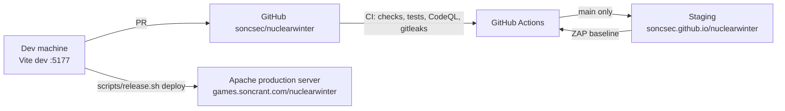

# Nuclear Winter — Architecture

> **Status:** APPROVED by owner 2026-10-18.

## 1. Overview

A static, single-page Phaser 4 game built with Vite, created from `soncsec/game-template`. There is no backend. The game rules run as plain TypeScript in `src/logic/`; Phaser scenes only draw and read input.



| Production item | Value |
|---|---|
| URL | `http://games.soncrant.com/nuclearwinter/` (also `soncrant.com/games/nuclearwinter/`) |
| Releases | `/srv/games-releases/nuclearwinter/<UTC time>-<commit>/`, 5 kept |
| Live link | `/var/www/html/soncrant.com/pub/games/nuclearwinter` → current release |
| Headers and CSP | Set by the portal's Apache games vhost (no changes needed) |

## 2. Architecture decisions

### Shared decisions

Recorded once in [`soncsec/star-destroyer` ARCHITECTURE.md](https://github.com/soncsec/star-destroyer/blob/main/ARCHITECTURE.md) and inherited unchanged:

| ADR | Decision |
|---|---|
| 002 | Phaser 4 game engine |
| 003 | TypeScript |
| 004 | Vite build, relative base, no runtime CDN |
| 005 | GitHub Pages staging, Apache production |
| 006 | Rules in engine-free `src/logic/` with unit tests; Playwright e2e with a test-only hook; seeded RNG |
| 007 | Security tooling: CodeQL, ESLint, npm audit, gitleaks, ZAP |
| 009 | Releases: `/srv/games-releases/<slug>/<id>/`, atomic symlink switch, rollback |
| 010 | HTTP on port 80 |
| 011 | Parallel games: one repo, folder, port and portal file per game |

No dependencies are added beyond the template's.

### ADR-NW01: Start from `game-template` — *Accepted*

- **Context:** The other games share a proven stack, CI and release pipeline.
- **Decision:** Create `soncsec/nuclearwinter` from `soncsec/game-template` and run `init-game.sh nuclearwinter "Nuclear Winter" 5177`.
- **Alternatives:** Copy Star Destroyer (brings another game's code); start from scratch (redoes proven work).
- **Tradeoffs:** Template updates are not pulled in automatically; we copy improvements by hand when useful.

### ADR-NW02: 384×216 native resolution, whole-number zoom in device pixels, landscape only — *Accepted*

- **Context:** The game must work on desktop, phone and tablet while keeping pixel art crisp. A phone in landscape is only about 390 CSS pixels tall, so the template's CSS-pixel zoom would leave the game at zoom 1 (tiny).
- **Decision:** Draw at 384×216 (16:9). Pick the largest whole-number zoom that fits the window in **device pixels** (`innerWidth × devicePixelRatio`), then size the canvas in CSS pixels as `384 × zoom / devicePixelRatio`. Landscape only: portrait shows a "rotate your device" overlay.
- **Alternatives:** 320×180 (smaller art budget, crops the 192–272 px tall skylines); a layout that adapts to any aspect ratio including portrait (much more layout and test work).
- **Tradeoffs:** Some letterboxing on non-16:9 screens. If phones look too small in M1 testing, fall back to 320×180 (an owner decision, since it changes this ADR).

### ADR-NW03: Engine-free geometric simulation at a fixed time step — *Accepted*

- **Context:** Missile Command needs no physics: missiles fly in straight lines and blasts are circles.
- **Decision:** `src/logic/` holds the whole simulation: warheads and counter-missiles as moving points on line segments, blasts as circles that grow then shrink, hits as point-in-circle tests. It advances in fixed steps (60 per second) using the seeded RNG. Scenes read its state and draw it, using pooled sprites.
- **Alternatives:** Phaser Arcade Physics (overlap checks between bodies; ties the rules to the engine and is harder to unit test).
- **Tradeoffs:** We write our own simple geometry. In return, the rules are fully unit tested and a seed plus inputs replays a game exactly, which also makes e2e tests deterministic.

### ADR-NW04: Glow from additive-blend sprites; bloom filter only when the frame rate allows — *Accepted*

- **Context:** "Slightly better graphics" means glow, but full-screen filters are the main performance risk on phones.
- **Decision:** Trails and explosions get their glow from additive-blended sprites and particles, which work on every device. Phaser 4's bloom filter is an optional high-quality layer, switched off automatically when the measured frame rate drops.
- **Alternatives:** Bloom filter everywhere (best look, risky on phones); no glow (fails the "modern take" goal).
- **Tradeoffs:** Two quality levels to test. The low level must still look finished.

### ADR-NW05: Waves from a formula, first waves set by hand — *Accepted*

- **Context:** Waves are endless, and the difficulty curve decides whether the game is fun.
- **Decision:** A pure function in `src/logic/` turns a wave number into a wave description (warhead count, speed, enemy mix, launch timing). Every coefficient lives in `src/config/tuning.ts`; the first few waves are explicit entries in the same file.
- **Alternatives:** Hand-author every wave (cannot be endless); fully random waves (uneven difficulty).
- **Tradeoffs:** The curve needs play-testing; a debug overlay (wave, counts, frame rate) in dev builds helps.

### ADR-NW06: One input path for mouse and touch — *Accepted*

- **Context:** Players use a mouse or a finger.
- **Decision:** Phaser pointer events only: a tap or click fires a counter-missile from the nearest base with ammo, aimed at that point. On desktop, keys (A/S/D and 1/2/3) optionally pick a base. No virtual joystick or on-screen aiming controls.
- **Alternatives:** Separate desktop and touch control schemes (twice the testing).
- **Tradeoffs:** A finger hides the target point; the blast is large enough that this does not matter much. Checked on a real phone in M1.

### ADR-NW07: Audio deferred — *Superseded by ADR-NW09*

- **Context:** The art pack has no audio; the owner wants audio after the MVP.
- **Decision:** No audio in version 1.0. Game events are emitted in one place, so sound can be hooked in later (M6). The source (generated with Web Audio or a CC0 pack) is decided with the owner before M6.

### ADR-NW08: Separate random streams for gameplay and visuals — *Accepted* (owner, 2026-10-18)

- **Context:** A seed must replay a game exactly, and the daily challenge (M3.5) depends on it. If particles, ash or screen shake drew from the gameplay RNG, any visual change would alter the waves.
- **Decision:** Three seeded streams from the one seed (`createStreams` in `src/logic/rng.ts`, each seed mixed apart):
  - `spawn`: the launch schedule (times, origins, speeds, enemy kinds, raiders). Every launch draws the same amount from it whatever the player does, so a seed, and so the daily challenge, always sends the same waves.
  - `aim`: choices that depend on play (targets of MIRV warheads and bomber drops).
  - `visual`: effects only; the rules never read it.
- **Alternatives:** One generator for everything (visual tweaks change gameplay); `Math.random()` for visuals (unseeded, so screenshots and e2e runs differ).
- **Tradeoffs:** Three streams to pass around. In return, the look can change freely without touching gameplay or the daily challenge.

### ADR-NW09: Sound effects generated in code with the Web Audio API — *Accepted* (owner, 2026-10-20)

- **Context:** M6 adds sound. The options were sounds generated in the browser or a CC0 sound pack (ADR-NW07).
- **Decision:** Every sound is built in the browser from short recipes (tones, sweeps, filtered noise, envelopes) in the arcade style. No audio files and no new dependency.
  - The recipes and the sample maths are plain TypeScript with unit tests: same recipe, same samples; peaks under a set limit; no silence or clipping.
  - At start-up the samples are copied into Web Audio buffers, and Phaser's sound manager plays them. Phaser already starts audio on the first tap or key (browsers block sound before one) and pauses it when the tab is hidden.
  - Any noise uses fixed seeds of its own, never the gameplay streams (ADR-NW08).
  - Each sound has a cap on copies playing at once, and a master volume sits under a safe limit.
  - A **mute** setting joins the settings screen and is saved with the other settings in localStorage. Older saved settings, without mute, still load as they are, with sound on.
  - No Content-Security-Policy change: generated buffers load nothing.
- **Alternatives:** A CC0 sound pack (needs approval of new third-party assets, adds download size, and has to be found to fit the style); Phaser's audio from files (same issue); a synth library (a new dependency for a handful of sounds).
- **Tradeoffs:** Generated sounds are simpler than recorded ones; that suits the retro look. Tuning them is code work rather than swapping files, so a sound sampler page lets the owner hear and approve them before they are wired in.

## 3. Code structure

```
src/
├── main.ts            Phaser config, device-pixel whole-number zoom, test hook in the e2e build only
├── config/tuning.ts   every gameplay number (sizes, speeds, ammo, scoring, wave formula, effects)
├── logic/             plain TypeScript, no Phaser imports (ESLint enforces), unit tested
│   ├── rng.ts         seeded RNG
│   ├── scaling.ts     zoom calculation
│   ├── world.ts       simulation state and fixed-step update
│   ├── geometry.ts    segments, circles, hit tests
│   ├── waves.ts       wave number → wave description
│   ├── scoring.ts     kill points, end-of-wave bonus, bonus cities, high score
│   ├── help.ts        "How to play" pages, built from the tuning numbers
│   ├── settings.ts    saved settings: reduce flashing, vibration, mute
│   ├── sound.ts       sound recipes rendered to samples (ADR-NW09)
│   └── voices.ts      cap on copies of each sound playing at once
├── entities/          pooled Phaser sprites that mirror logic state
├── scenes/            Title and Game (HUD, pause, wave and game-over screens): thin, call into logic/
│   ├── audio.ts       generated sound buffers played through Phaser's sound manager, with mute
│   ├── HelpScene.ts   "How to play" pages
│   └── ui.ts          backdrop, centred text and localStorage access shared by the scenes
└── debug/             testHook.ts: window.__game for Playwright (e2e build only);
                       DebugOverlay.ts: frame rate and counts (dev and e2e builds; production only with ?debug, as a separate chunk)
public/assets/         art copied from legacy/ (listed in CREDITS.md) and the font
tests/
├── unit/              Vitest, 80% coverage floor on src/logic
├── e2e/               Playwright in Chromium, Firefox and WebKit: desktop, phone and tablet viewports, production CSP
└── release/           release scripts against a fake server
scripts/               release.sh, release-remote.sh, smoke_test.py, zap_check.py, check_repo.py
tools/docs-page/       builds the docs page from the four docs
```

## 4. Key technical practices

- All gameplay numbers in `tuning.ts`; seeded RNG for anything random; object pools for missiles, blasts and particles.
- E2E tests drive the game through the test hook and the gameplay clock, not wall-clock waits.
- The canvas is checked to be scaled by a whole number on desktop and phone viewports.
- The npm build scripts set `VITE_BUILD` to the commit's first 8 hex digits; the title screen shows it as the build number, matching the end of the release id. It is the only `VITE_` variable, so nothing else from the environment reaches the bundle.

## 5. Delivery pipeline

- **PR:** repo checks, gitleaks, `npm audit`, format, lint, typecheck, unit tests with coverage, release-script tests, build, Playwright (Chromium, Firefox and WebKit), CodeQL.
- **Merge to `main`:** deploy to GitHub Pages staging, then the ZAP baseline scan.
- **Release:** `scripts/release.sh deploy` from the dev machine (standing owner approval after each merge), with smoke test and automatic rollback.

## 6. Development environment

Node 24.21.0 from nvm. `npm run dev` serves on http://localhost:5177. `npm run check` runs everything CI runs except the audit.
